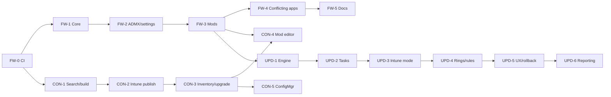

# Phase plan - WingetFW, WingetFW Console, WingetFW-Update

> Status: draft. Details per phase are in the specs:
> [WingetFW](Spec-WingetFW.md), [WingetFW Console](Spec-WingetFW-Console.md), [WingetFW-Update](Spec-WingetFW-Update.md).

## 1. Order

Phases are named `<project>-<number>`: `FW` = WingetFW, `CON` = WingetFW Console, `UPD` = WingetFW-Update.
A phase starts when the phases it depends on are done.

| Step | Phase | Content | Depends on |
|---|---|---|---|
| 1 | FW-0 | CI: PSScriptAnalyzer + Pester, VM suite on release, release workflow, signing | 5.0.0 |
| 2 | FW-1 | WingetFW.Core: settings reader, logging, event log channel, state files | FW-0 |
| 2 | CON-1 | Search, manifest details, command line, detection script | FW-0 |
| 3 | FW-2 | ADMX/ADML, device settings, sources | FW-1 |
| 3 | CON-2 | Intune publish | CON-1 |
| 4 | FW-3 | Mods: template, fetch/cache, load checks, sections, 69002 | FW-2 |
| 4 | CON-3 | Inventory and WingetFW upgrade of apps | CON-2 |
| 5 | FW-4 | Conflicting apps (`PreInstall` example) | FW-3 |
| 5 | UPD-1 | Engine, ESP check, manual mode | FW-3 |
| 6 | FW-5 | Docs: Docs\Configuration.md (ADMX reference), Docs\Mods.md, Docs\Signing.md, README links | FW-4 |
| 6 | CON-4 | Mod editor, signing, effective settings view | FW-3, CON-3 |
| 6 | UPD-2 | Scheduled tasks (SYSTEM + user) | UPD-1 |
| 7 | UPD-3 | Intune mode (remediation, Win32 app), WDAC test | UPD-2 |
| 7 | CON-5 | ConfigMgr publish | CON-3 |
| 8 | UPD-4 | Rings, release rules, pins, maintenance window, metered/battery | UPD-3 |
| 9 | UPD-5 | PSADT user experience, rollback | UPD-4 |
| 10 | UPD-6 | Reporting and health check | UPD-5 |

Phases with the same step number can run at the same time.

## 2. Checklist

### WingetFW

- [x] FW-0 CI and release workflow - done when the pipeline is green on GitHub
- [x] FW-1 WingetFW.Core - done when Pester covers every settings level combination
- [x] FW-2 ADMX and settings - done when the VM shows policy > command line > mod > local key > config
- [x] FW-3 Mods - done when the VM runs local/UNC/blob mods and rejects unsigned, unknown-source and top-level-code files
- [x] FW-4 Conflicting apps - done when the VM removes an old MSI in PreInstall before install
- [x] FW-5 Docs - done when reviewed

### WingetFW Console

- [x] CON-1 Search and build - done when output matches hand-made apps that pass the VM suite
- [x] CON-2 Intune publish - done when an app created in a test tenant installs on the VM
- [x] CON-3 Inventory and upgrade - done when the dry-run equals the update tool output
- [x] CON-4 Mod editor - done when a mod created in the Console runs on the VM
- [ ] CON-5 ConfigMgr publish - done when an app created in a lab site installs

### WingetFW-Update

- [ ] UPD-1 Engine - done when the VM upgrades only allowed apps, mod sections run and nothing runs during ESP
- [ ] UPD-2 Scheduled tasks - done when tasks are created and removed by policy
- [ ] UPD-3 Intune mode - done when it works on a WDAC test device
- [ ] UPD-4 Rings and rules - done when Pester covers every rule and the VM tests each ring
- [ ] UPD-5 UX and rollback - done when the VM shows deferral and restart prompt
- [ ] UPD-6 Reporting - done when data is visible in the Workbook

## 3. Release per phase

- Every finished phase gets a CHANGELOG entry and a version number.
- WingetFW phases that change the package are released as a new `Toolkit\WinGetFW<version>` folder.
- A release needs a green VM suite (self-hosted runner, manual or tag).
